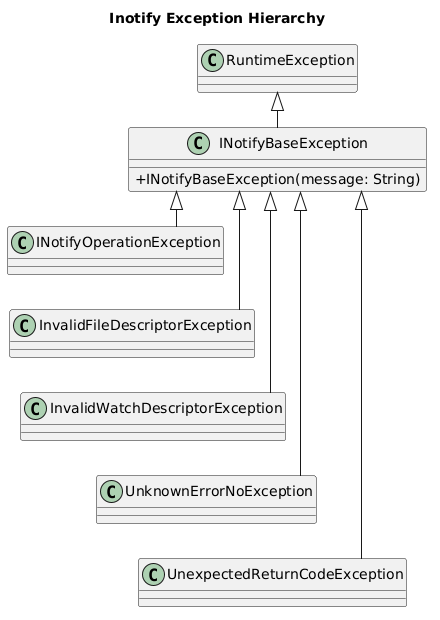
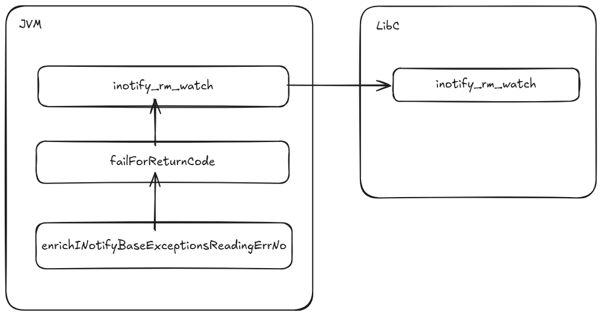

> Photo taken from [pixabay](https://pixabay.com/photos/panama-city-panama-panama-avenue-2189313/)
      
Been Thinking about how to properly handle error codes returned from invoking native functions using Java Panama recently. Also tempted to apply some `Exception` classe hierarchies, I kept dreaming how a container aware approach would look like? what it would take to apply [IoC](https://en.wikipedia.org/wiki/Inversion_of_control)  here.

<!-- more -->

I'll explain my 3 attempts at finding ways to build an intuition for building a container aware means for handling errors when working with Java's Foregin Functions and Memory APIs. All my attempts are about translating error codes returned by `inotify_rm_watch` into an `Exception` class Hierarchy as shown in the following class diagram:



**Note** 
> `inotify_rm_watch` docs can be found [here](https://man7.org/linux/man-pages/man2/inotify_rm_watch.2.html)

**Note**
> If you are new to project Panama you can read my previous blog posts for an introduction [here](./b-2026-04-06-itpplnl-p1.md).


## Attempt 1: Just Check the Error Code

Base idea is very clear: Just read the error code returned from `inotify_rm_watch` invocation, and map it to an Exception class.
```java
public static void checkTheReturnValueOfDownCallAndThrowException(MethodHandle inotifyRmWatch) throws Throwable {
    var returnCode = (int) inotifyRmWatch.invoke(Integer.MAX_VALUE, Integer.MAX_VALUE);
    if (returnCode == -1) {
        throw new INotifyOperationException("operation failed");
    }
}
```

Here is the test for this demo: 

```java
@DisplayName("Basic error handling by checking the return value of downcall handle")
@Test
public void checkingReturnValueForErrors() {
    try (var arena = Arena.ofConfined()) {
        // GIVEN
        var libCHelpers = new LibCDownCallHelpers(arena);
        var inotifyRmWatchFunctionDescriptor = FunctionDescriptor.of(
                ValueLayout.JAVA_INT, ValueLayout.JAVA_INT, ValueLayout.JAVA_INT
        );

        var inotifyRmWatchHandler = assertDoesNotThrow(() ->
                libCHelpers.findDownCallHandle("inotify_rm_watch", inotifyRmWatchFunctionDescriptor)
        );
        
        // THEN
        assertThrows(INotifyOperationException.class, () -> {
            ErrorHandlingDemo.checkTheReturnValueOfDownCallAndThrowException(inotifyRmWatchHandler);
        });
    }
}
```

Also Here is the source code for `rs.pub.reza.panama.errorhandling.LibCDownCallHelpers`, which contains utilities to  find methods in the Lib C:
```java

package rs.pub.reza.panama.errorhandling;

import java.lang.foreign.Arena;
import java.lang.foreign.FunctionDescriptor;
import java.lang.foreign.Linker;
import java.lang.foreign.SymbolLookup;
import java.lang.invoke.MethodHandle;

public class LibCDownCallHelpers implements AutoCloseable {

    private final Arena memoryArena;
    private final Linker linker = Linker.nativeLinker();

    private final SymbolLookup libCSymbolLookup;

    public LibCDownCallHelpers(Arena lookupArena) {
        this.memoryArena = lookupArena;
        this.libCSymbolLookup = SymbolLookup.libraryLookup("libc.so.6", memoryArena);
    }

    public MethodHandle findDownCallHandle(String functionName, FunctionDescriptor descriptor) {
        return linker.downcallHandle(
                libCSymbolLookup.findOrThrow(functionName),
                descriptor
        );
    }

    public MethodHandle findDownCallHandleWithLinkerOptions(String functionName, FunctionDescriptor descriptor, Linker.Option... options) {
        return linker.downcallHandle(
                libCSymbolLookup.findOrThrow(functionName),
                descriptor,
                options
        );
    }

    @Override
    public void close() throws Exception {
        memoryArena.close();
    }
}
```

### Simple enough!
This approach is very straight forward, just read the code, if it is negative (or within a certain range)  throw the proper exception. Now let's see if we can
throw some cool IoC ideas at it.

## Attempt 2: From Return Code to Exception
Following my motivation to build a baseline for separating the concern of Error Handling from where the `DownCall` method handle is executed,
we can take advantage of `MethodHandle::filterReturnValue` to extract the error code to Exception translation logic.

Here is the idea, say we have : `failForReturnCode` method defined as:

```java
public class INotifyErrorHelpers {
    private final static int EBADF = 9;
    private final static int EINVAL = 22;


    public static int failForReturnCode(int returnCode) {
        switch (returnCode) {
            case -1:
                throw new INotifyOperationException();
            case 0:
                return returnCode;
            default:
                throw new UnexpectedReturnCodeException(returnCode);
        }
    }
 // ...
}
```

**Note**
> The return value is `int`, same as `inotify_rm_watch`

Then we can do somethng cool by adding this seperated concern on top of the `inotify_rm_watch` MethodHandle:

```java
public static void checkTheReturnValueUsingFilterReturnValue(MethodHandle inotifyRmWatch) throws Throwable {
    var filterReturnValueHandler = MethodHandles.
            lookup()
            .findStatic(INotifyErrorHelpers.class,
                    "failForReturnCode",
                    MethodType.methodType(int.class, int.class)
            );

    var decoratedRmWatchHandler = MethodHandles.filterReturnValue(inotifyRmWatch, filterReturnValueHandler);

    decoratedRmWatchHandler.invoke(Integer.MAX_VALUE, Integer.MIN_VALUE);
}
```

Now, the error code translation sits on top of the original native `inotify_rm_watch` MethodHandler!

Let's write the test:

```java
@DisplayName("Check the Return using MethodHandle::filterReturnValue")
@Test
public void checkingReturnValueForErrorsUsingFilterReturnValue() {
    try (var arena = Arena.ofConfined()) {
        // GIVEN
        var libCHelpers = ...
        var inotifyRmWatchFunctionDescriptor = ...

        var inotifyRmWatchHandler = ...

        // THEN
        assertThrows(INotifyOperationException.class, () -> {
            ErrorHandlingDemo.checkTheReturnValueUsingFilterReturnValue(inotifyRmWatchHandler);
        });
    }
}
```

### Seprataed the concern!
A baby step done nicely! We decorated the raw native `inotify_rm_watch` MethodHandle and then separated the error code translation step.
The error code translation is basically "docrated" by implementing function composition using a method handler combinator.


## Attempt 3: Sometimes, It is more than Return Code

There are cases where inspecting returned error code is not enough. If you have looked up the Man pages for `inotify_rm_watch` you'll encounter the following:

```
RETURN VALUE        
       On success, inotify_rm_watch() returns zero.  On error, -1 is
       returned and errno is set to indicate the error.
ERRORS         
       EBADF  fd is not a valid file descriptor.

       EINVAL The watch descriptor wd is not valid; or fd is not an
              inotify file descriptor.
```

From the text above in [documentation](https://man7.org/linux/man-pages/man2/inotify_rm_watch.2.html), we can conclude that in order to understand "what" has gone wrong, we need to inspect the value of `errno` variable, which can contain two of following error codes: `EBADF` or `EINVAL`.

In Java 20, The idea of "Capture Call State" has been introduced as Linker option via `Linker.Option.captureCallState` and stablized in [JEP 454](https://openjdk.org/jeps/454). The idea is to capture state or information that exists outside the return value of native function.

In our case of `inotify_rm_watch` we need to read the `errno` set by function to better understand what has gone wrong.

### Preparing the Setup

To read `errno` we need some ground work in place:

1- Adding Linker Option
2- Defining the memory layout
3- Allocating memory for capturing `errno`

We start by applying these in the test as explained by the comment first:

```java
@DisplayName("Using Linker.Option::captureCallState")
@Test
public void checkingErrorNoUsingCaptureCallState() {
    try (var arena = Arena.ofConfined()) {
        var libCHelpers = new LibCDownCallHelpers(arena);

        // Setup the linker Option
        var captureErrNoDuringExecutionLinkerOption = Linker.Option.captureCallState("errno");
        // define the moemory layout
        var captureErrNoMemoryLayout = Linker.Option.captureStateLayout();
        // allocating memory from the Arena 
        var captureErrNoMemorySegment = arena.allocate(captureErrNoMemoryLayout);

        var inotifyRmWatchFunctionDescriptor = ...

        var inotifyRmWatchHandler = assertDoesNotThrow(() ->
                libCHelpers.findDownCallHandleWithLinkerOptions("inotify_rm_watch",
                        inotifyRmWatchFunctionDescriptor,
                        captureErrNoDuringExecutionLinkerOption) // Then pass the Linker Option
        );

        var exception = assertThrows(INotifyOperationException.class, () -> {
            ErrorHandlingDemo.checkTheReturnValueAndReadErrorNoForEnrichingExceptionDetails(inotifyRmWatchHandler, captureErrNoMemoryLayout, captureErrNoMemorySegment);
        });

        assertNotNull(exception.getCause());
        assertInstanceOf(InvalidFileDescriptorException.class, exception.getCause());
    }
}
```

Here is how the `Linker.Option` is passed down by `findDownCallHandleWithLinkerOptions` as last argument to `Linker::downCallHandle`.

```java
public MethodHandle findDownCallHandleWithLinkerOptions(String functionName, FunctionDescriptor descriptor, Linker.Option... options) {
    return linker.downcallHandle(
            libCSymbolLookup.findOrThrow(functionName),
            descriptor,
            options
    );
}
```

**Note**
>When the linker option `Linker.Option.captureCallState("errno")` is passed down, the returned Method Handle will now take following signature:
```
(MemorySegment, int, int)int
```

>This implies that the `MemorySegment` should be provided now as first argument to `MethodHandle::invoke` for the returned `MethodHandle`.

### Reading `errno` from its memory

Next we define `enrichINotifyBaseExceptionsReadingErrNo` static method which demonstrates how it reads `errorno` using provided `MemorySegment` and `VarHandle`.
It tries to understand the underlying error code stored in `errno` and then sets proper exception for `initialCause` on the `Exception` thrown originally by `failForReturnCode`:

```java
public static int enrichINotifyBaseExceptionsReadingErrNo(INotifyBaseException ex, VarHandle errNoVarHandle, MemorySegment capturedErrNo) {
    var errNo = (int) errNoVarHandle.get(capturedErrNo, 0L);

    var cause = switch (errNo) {
        case EBADF -> new InvalidFileDescriptorException("Invalid fd");
        case EINVAL -> new InvalidWatchDescriptorException("Invalid wd");
        default -> new UnknownErrorNoException(errNo);
    };

    ex.initCause(cause);
    throw ex;
}
```

### Decorating Method Handler with Exception enrichment
Finally this code demonstrates how all pieces fall into place together. `checkTheReturnValueAndReadErrorNoForEnrichingExceptionDetails` first builds the `VarHandle` from the provided memory layout. Then the codes decorates the raw `inotify_rm_watch` `MethodHandle` the following way:

1- provide the raw `inotify_rm_watch` with the required `MemorySegment` in order to keep the invocation signature same as before: `(int, int)int` 
2- decorate the raw `inotify_rm_watch` with method handle of `failForReturnCode` so that a negative return code will throw a generic `Exception`.
3- add another decoration layer via `MethodHandlers::catchException` and provide all the necessary dependency to it to read `errno`: The `VarHandle` and the `MemorySegment`



Here is the code that glues all of above together:

```java
public static void checkTheReturnValueAndReadErrorNoForEnrichingExceptionDetails(MethodHandle inotifyRmWatchHandler, StructLayout captureErrNoMemoryLayout, MemorySegment captureErrNoMemorySegment) throws Throwable {
    // 1. The method handler now requires the memory segment to be provided for
    // capturing the state of errno variable.
    // we provide this argument via MethodHandle so the signature of invocation looks same as before:
    // (int, int)int
    var decoratedHandler = provideMethodHandleArgument(
            inotifyRmWatchHandler,
            0,
            captureErrNoMemorySegment
    );

    // 2. convert return code to exception
    var filterReturnValueHandler = findStaticMethodHandle(INotifyErrorHelpers.class,
            "failForReturnCode",
            MethodType.methodType(int.class, int.class)
    );
    
    decoratedHandler = MethodHandles
            .filterReturnValue(decoratedHandler, filterReturnValueHandler);


    // 3. Setup the exception handler and provide the memory dependency to be able to read 
    // the errno when an exception is thrown by "failForReturnCode".
    var exceptionEnrichHandler = findStaticMethodHandle(INotifyErrorHelpers.class,
            "enrichINotifyBaseExceptionsReadingErrNo",
            MethodType.methodType(int.class,
                    INotifyBaseException.class,
                    VarHandle.class,
                    MemorySegment.class
            )
    );

    var errNoVarHandle = captureErrNoMemoryLayout.varHandle(
            MemoryLayout.PathElement.groupElement("errno")
    );

    // provide the VarHandle and memory segment that is required by the
    // exception enrichment method.
    exceptionEnrichHandler = provideMethodHandleArgument(
            exceptionEnrichHandler,
            1,
            errNoVarHandle,
            captureErrNoMemorySegment
    );

    // register the enricher handler method with its dependencies provided as a
    // exception try-catch block on the decorated rm watch handler.
    decoratedHandler = MethodHandles
            .catchException(decoratedHandler, INotifyBaseException.class, exceptionEnrichHandler);


    decoratedHandler.invoke(Integer.MAX_VALUE, Integer.MIN_VALUE);
}
```

### Feels like IoC
We achieved quite a few wins with 3rd attempt:

- Extracting error handling concern at call site into a separate layer
- Enabled extending the error details and providing (injecting) the memory handling dependencies (it is kind of hairy for now, but we did it)

3rd approach provides the baseline I have in mind. It enables adding more sophisticated ways of error handling thanks to decorated `MethodHandle`s. 

My hope is that approaches like this, can help us to maintain clean Error handling and Exception translation layers. Thanks to ideas we already know in Java and IoC patterns!

## Code
Whole code can be found [here](https://github.com/rasouli/java-panama-experiments/tree/main/java-panama-error-handling).

## What's next then?

In next part, implementing a clean `Annotation` driven error handling based on approach 3, should really help it shine.

